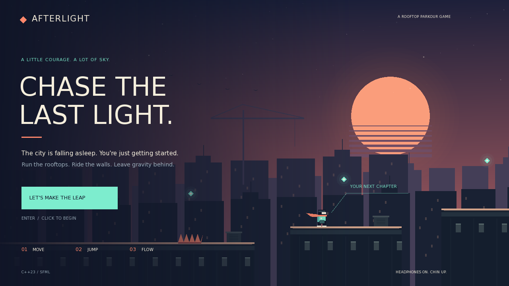

# AFTERLIGHT

A C++23 / SFML 3.1 rooftop parkour game built to be played **and** understood.
Run through a neon city, chain jumps and air dashes, climb walls, collect
light, and reach the end of the skyline. The visuals are drawn in code; the
only bundled external asset is the openly licensed DejaVu Sans font.



## Build and play

This version uses **C++23 and SFML 3.1** (also compatible with later 3.x
versions). It no longer uses the SFML 2 API. CMake 3.20 or newer and a
C++23 compiler are required; GCC 14 or newer is recommended for the
MSYS2 UCRT64 workflow.

### Windows: MSYS2 UCRT64 + Embarcadero Dev-C++

Follow the complete [Windows setup guide](docs/windows-ucrt64.md). It covers
installing matching UCRT64 packages, using Dev-C++ as your editor, building,
running, and fixing missing DLL or compiler errors. Use the UCRT64 GCC
compiler even if Dev-C++ also bundles an older compiler.

In the **MSYS2 UCRT64** terminal, update the system (reopen that same terminal
and repeat if the update asks you to close it), then install the tools:

```sh
pacman -Syu
pacman -S --needed mingw-w64-ucrt-x86_64-gcc mingw-w64-ucrt-x86_64-cmake mingw-w64-ucrt-x86_64-ninja mingw-w64-ucrt-x86_64-sfml
cd /c/path/to/Project-alpha
bash scripts/build-ucrt64.sh
./build-ucrt64/afterlight.exe
```

The helper verifies that the UCRT64 tools are selected, builds all four C++
files, copies the assets, and runs the headless physics checks. CMake requires
SFML **3.1 or newer 3.x**; if your package mirror still supplies an older
release, see the setup guide instead of mixing libraries from another
compiler. To launch later from Explorer, double-click
`scripts/run-ucrt64.bat`. The successful build saves the selected SFML and
UCRT64 runtime folders for that launcher, including custom SFML installs.
Keep those installed tools available. Rebuild once after updating an older
copy of the helper; Explorer does not inherit your terminal's DLL search path.

### Other platforms

Install SFML **3.1** development libraries with a matching compiler, or build
that release from [official SFML source](https://github.com/SFML/SFML/tree/3.1.0).
A distribution package named `libsfml-dev` may still be SFML 2.x: check its
version before using it. From the folder containing this README:

```sh
cmake -S . -B build -DCMAKE_BUILD_TYPE=Release
cmake --build build --parallel 2
ctest --test-dir build --output-on-failure
./build/afterlight
```

For a custom SFML installation, add
`-DCMAKE_PREFIX_PATH=/path/to/your/sfml-install` when configuring CMake. The
build copies `assets/` beside the executable. Keep that folder with the
program. A graphical desktop/display is required for interactive play.

## Controls

| Key | Action |
| --- | --- |
| A / D or Left / Right | Run |
| Space / W / Up | Jump; hold for more height |
| Shift or X | Dash in the direction you face |
| R | Return to the current checkpoint |
| Escape | Pause / resume |
| Enter | Start / restart after finishing |
| M | Mute / unmute sound |
| F3 | Toggle performance information |

Jump toward a wall and press jump again to kick away from it. Touching the
ground restores your dash. Checkpoints keep a mistake from sending you all
the way back to the start. Collectibles are optional: first learn to reach
the finish, then try a faster, cleaner run.

## Checks

```sh
./build/afterlight --self-test
ctest --test-dir build --output-on-failure
```

On Windows, replace `build` with `build-ucrt64` and use `afterlight.exe`.
These invoke the same built-in physics checks. They run without a window,
so a desktop session is not needed. They exercise gameplay rules rather
than only checking whether the project compiles. An interactive playthrough
is still useful for judging how the controls feel.

The rendering smoke test opens a window, runs scripted input for 900 fixed
simulation steps with sound muted, and exits. Screenshot mode renders a
representative gameplay view, saves it, and exits:

```sh
./build/afterlight --smoke-test
./build/afterlight --screenshot afterlight.png
```

On a Linux server without a monitor, install `xvfb` and run those windowed
checks with a virtual display instead:

```sh
xvfb-run -a ./build/afterlight --smoke-test
xvfb-run -a ./build/afterlight --screenshot afterlight.png
```

The screenshot is a local image file, not an interactive web version. The
game is a native desktop program.

Use `--mute` to start silently without opening an audio device, or combine
`--title-screen` with `--screenshot title.png` to capture the title artwork.
Enter while paused restarts the entire run; Escape resumes from that pause.

### Prepared cloud workspace

For development in this cloud machine, activate the separately installed
SFML 3.1 tools and use a fresh build folder:

```sh
source /workspace/.sfml31-tools/activate.sh
cmake -S /workspace/Project-alpha -B /workspace/Project-alpha/build-sfml31 -G Ninja -DCMAKE_BUILD_TYPE=Release
cmake --build /workspace/Project-alpha/build-sfml31 --parallel 2
ctest --test-dir /workspace/Project-alpha/build-sfml31 --output-on-failure
```

Those paths are specific to this cloud machine. On Windows, use the UCRT64
instructions instead. A virtual display can validate rendering on a server;
interactive play needs a graphical desktop.

## A beginner's map of the code

Start with `include/World.hpp`: it describes the things in the game without
drawing them. Then read `src/World.cpp` to see how they move and interact.
Read `src/main.cpp` next to see how input, simulation, drawing, and time fit
together. `src/Renderer.cpp` turns the world into a picture; `src/Audio.cpp`
handles sound. `CMakeLists.txt` explains how the compiler combines the files.
The comments explain the purpose of each part and the less obvious math.

Some terms you will meet:

- A **variable** is a named piece of information, such as the player's speed.
- A **type** says what kind of information it holds: `float` is a number
  with a fractional part, and `bool` is either `true` or `false`.
- A **struct** groups related information, like a position and a velocity.
- A **function** is a named set of instructions. Its parameters are inputs;
  a return value, when present, is its output.
- A **class** keeps a group of data and functions together. `World` owns
  the playable level and the rules that update it.
- A **vector** in `std::vector` is a growable list. `sf::Vector2f`, despite
  the similar name, is one pair of coordinates: an x value and a y value.
- A **header** (`.hpp`) declares shared types and functions. A source file
  (`.cpp`) supplies their behavior.
- `std::` names the C++ standard library; `sf::` names SFML. Implementation
  files use `using namespace std;` where helpful. Headers keep the explicit
  prefix so they do not unexpectedly change names in every file including
  them.

SFML's screen coordinates start at the upper-left corner. Positive x moves
right, and positive y moves down. That is why gravity increases vertical
velocity while jumping initially makes it negative. The world is wider
than the window: the camera chooses which part of it you can see.

The main loop collects key presses, advances the simulation in small fixed
time steps, and draws the latest result. A fixed time step means physics
uses the same small slice of time even when drawing speed varies. Velocity
means distance per second; acceleration changes that velocity over time.

Parkour should feel forgiving. **Coyote time** briefly allows jumping after
leaving an edge. **Jump buffering** remembers a jump pressed just before
landing. **Variable jump height** lets releasing the key shorten a jump.
These small rules make a bigger difference than increasing top speed.

## Try a small change

Make one change at a time, rebuild, and play:

1. Find the movement constants in `src/World.cpp` and change running speed.
2. Change a platform's rectangle to move or resize a rooftop.
3. Change a color in `src/Renderer.cpp` to give the city a new palette.

Keep physics measurements in the simulation. Camera offsets and visual
effects belong in rendering, so changing the way a jump looks does not
accidentally change whether it clears a gap.

The bundled font's attribution and redistribution terms are in
`assets/LICENSE-font.txt`.
