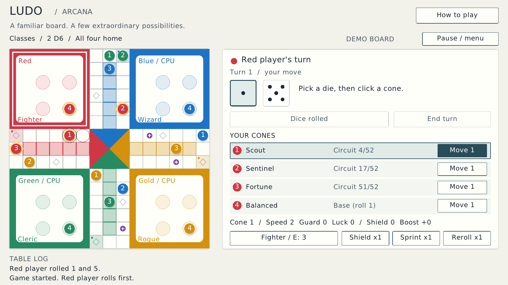

# Ludo / Arcana

A C++23 desktop Ludo game with a simple four-color board, readable text,
and optional fantasy rules. Play with **one to four people on the same
computer**, add computer opponents up to four total seats, or play a solo
race. Each player has four numbered cones.

The board follows the familiar red, blue, yellow, and green layout in the
reference image. The landscape interface is optimized for a **1920 × 1080**
laptop display. The window automatically fits inside the available desktop,
accounting for the Windows taskbar, title bar, and borders. It also supports
resizing and borderless fullscreen. This is a separate **raylib 6.2** application; it
does not require SFML and does not replace the repository's other games.



[Lobby and mode selection](docs/lobby.png)

## Build on Windows

Your installed **MSYS2 UCRT64** GCC, CMake, Ninja, and raylib 6.2 packages
are the required tools. Download the complete
[Project-alpha source ZIP](https://github.com/hassanabbas9871-byte/Project-alpha/archive/refs/heads/main.zip)
and extract it. Keep the whole repository because Ludo uses the licensed
font in the parent `assets` folder.

In the **UCRT64** terminal, run:

```sh
cd "/d/Project-alpha-main/ludo"
bash scripts/build-ucrt64.sh
./build-ucrt64/ludo.exe
```

Replace the example folder with your own extracted path. Keep quotation
marks around paths containing spaces. The helper checks that the compiler
and build tools belong to UCRT64, selects its raylib installation, builds
the game, copies the font and license, and runs the rules tests.

After a successful build, launch from **File Explorer** by double-clicking:

```text
ludo/scripts/run-ucrt64.bat
```

You can create a desktop shortcut to that batch file. It restores the DLL
search path recorded by the successful build without changing Windows'
global settings. Keep MSYS2 installed and the generated `assets` folder
beside the EXE. Moving only the EXE to another machine does not include
its runtime DLLs or font. If you move MSYS2 itself, rebuild once or set
`MSYS2_ROOT` to its new folder for the launcher.

Use **Embarcadero Dev-C++ as an editor**, then rebuild with the helper.
If you configure a compiler inside Dev-C++, select the GCC in your actual
`msys64\ucrt64\bin` folder. Compile the CMake project rather than one
`.cpp` file: the complete game includes the rules and text implementations.

## Rules and controls

Choose human and computer seats, a mode, one or two dice, and the victory
goal in the lobby. All human players share the mouse; the turn panel tells
you whose move it is. Computer seats take their own turns.

1. **Roll the dice.** Each die is an ordinary D6 with faces 1 through 6.
2. A cone can leave its base **only by spending a die showing 1**. You need
   a new 1 for every cone you bring out. Movement boosts never bypass this.
3. Choose an unused die and whichever of your own legal cones you want
   to move. With two dice, spend them separately in your chosen order;
   you may use both on the same cone or split them between cones.
4. Travel clockwise along the shared track, then enter your colored home
   lane and reach the center. Finishing requires the **exact** remaining
   number; you cannot overshoot.
5. Landing on an opponent on an unprotected track square sends that cone
   back to base. Marked safe squares protect everyone standing there.
   Friendly cones may share a square; they do not form blocking walls.
6. After your usable dice are spent, end the turn. Rolling a 6 does not
   award an extra roll. If no move is legal, you can pass.

By default, **all four cones must reach home** before a player earns a
place. The others continue for later places; the final remaining player
receives the last place. For a shorter race, choose **First cone** in
the lobby. In that variant, a player's remaining cones stop participating
as soon as their first cone finishes. A one-seat game ends when that
player completes the selected goal.

| Control | Action |
| --- | --- |
| Mouse | Choose setup options, dice, cones, and available abilities |
| `Space` | Roll, or end the turn when allowed |
| `Escape` | Pause / resume; return to the lobby through the pause menu |
| `F9` | Fit and center the window inside the available desktop |
| `F11` | Toggle borderless fullscreen |

Use the visible die and cone controls to inspect legal moves. The event log
explains deployments, captures, boosts, and finishing places. Enhanced modes
also expose each cone's individual stats and active effects.

The board, controls, text, and mouse targeting share the same display transform.
The game uses native pixels rather than raylib's extra Windows window-enlarging
DPI flag, so 125% or 150% Windows scaling does not enlarge the game past the
desktop or separate labels from their shapes. You do not need to change your
Windows display settings. F11 restores the previous window size when leaving
fullscreen; F9 brings an oversized or displaced window back onto the desktop.

## Modes

**Basic** is Ludo without power-ups, classes, or cone-stat modifiers. Every
cone follows the same movement and capture rules. You can still choose
the player count, dice count, and victory goal.

**Classes** adds fantasy role-playing classes and distinct cone stats.
Each player chooses a class; its ability can be used once per turn when
the player has enough energy. Energy starts at 3, returns by 1 on each
subsequent turn, and is capped at 6. Shields on a cone are capped at 3.

| Class | Ability | Energy |
| --- | --- | --- |
| Fighter | Add two shields to one active cone | 2 |
| Rogue | Arm a sprint of 3 plus the cone's Speed | 2 |
| Wizard | Change an unused die to 1 | 2 |
| Cleric | Add one shield to every active friendly cone | 3 |
| Ranger | Arm a sprint of 1 plus Speed and add one shield | 2 |
| Monk | Arm a sprint of 2 plus Speed | 1 |

An active cone has left base and has not finished. A sprint is an optional
boost armed for that cone's next normal move; it never deploys a cone and
cannot be stacked with another armed sprint. It can make a move overshoot,
so inspect the destination before spending it. A shield absorbs one capture
attempt instead of sending that cone to base; the attacking cone may then
share the square.

The four cones also have individual profiles when cone stats are enabled:

| Cone profile | Speed | Guard | Luck |
| --- | --- | --- | --- |
| Scout | 2 | 0 | 0 |
| Sentinel | 0 | 1 | 0 |
| Fortune | 0 | 0 | 2 |
| Balanced | 1 | 0 | 1 |

**Speed** increases deliberately armed sprints rather than every die roll.
**Guard** grants shields when that cone leaves base. **Luck** increases
energy from power-up pickups. Inspecting a cone shows its stats and effects.

**Anime** offers original anime-inspired presets and class names:
Iron Vanguard, Storm Runner, Star Weaver, Dawn Keeper, Spirit Archer, and
Dragon Monk correspond to the six class kits above. Their themes and names
belong to this game rather than adapting a particular series. The required
die showing 1 to leave base remains unchanged.

| Anime preset | Rules |
| --- | --- |
| Aura League | Classes, individual cone stats, power-up cards, and captures |
| Mecha Circuit | Classes, individual cone stats, and captures; pickups restore energy, with no power-up cards |
| Spirit Festival | Classes and power-up cards, with equal cone stats and captures disabled for a peaceful race |

**Custom** lets you choose the modifiers independently, including class
bonuses, individual cone stats, and power-ups. This is useful for keeping
the familiar board while selecting only the extra rules you enjoy.

Enhanced games include **Shield**, **Sprint**, and **Reroll** power-ups.
When power-ups are enabled, players start with one of each. Landing on a
marked pickup square awards a random card, up to three of each type, and
energy equal to 1 plus that cone's Luck. **Shield** adds one shield to an
active cone. **Sprint** arms a boost of 2 plus Speed, capped at 6 movement
steps. **Reroll** changes one unused die and is limited to once per turn.
The on-screen controls explain valid targets and current availability.

## Build and check elsewhere

With a C++23 compiler, CMake 3.20 or later, and raylib 6.2 installed, run
these commands from the repository root:

```sh
cmake -S ludo -B ludo/build -DCMAKE_BUILD_TYPE=Release
cmake --build ludo/build --parallel 2
ctest --test-dir ludo/build --output-on-failure
./ludo/build/ludo
```

For a custom raylib prefix, add
`-DCMAKE_PREFIX_PATH=/path/to/raylib/install` when configuring. Interactive
play requires a graphical desktop.

The real rules can be tested without raylib or a window:

```sh
cmake -S ludo -B ludo/build-tests -DLUDO_BUILD_APP=OFF
cmake --build ludo/build-tests --parallel 2
ctest --test-dir ludo/build-tests --output-on-failure
```

The app also supports automated graphical checks:

```sh
./ludo/build/ludo --smoke-test
./ludo/build/ludo --screenshot ludo.png
./ludo/build/ludo --screenshot lobby.png --screen lobby
./ludo/build/ludo --screenshot classes.png --mode classes
```

Use `--mode basic|classes|anime|custom` to preselect a lobby mode, or
`--demo` to open a demonstration board. Screenshot matches are labelled
previews with arranged pieces; normal games start with every cone in base.

On Windows, use `build-ucrt64/ludo.exe` in UCRT64 or pass the arguments
to `scripts/run-ucrt64.bat`. On a Linux server, use Xvfb for graphical
checks. The game is a native desktop program, not a browser application.

## A beginner's guide to the code

- **`include/Ludo.hpp`** describes players, cones, dice, settings, and the
  commands the game can perform. A `struct` groups related values.
- **`src/Ludo.cpp`** implements those rules without drawing anything.
  Keeping rules independent lets tests exercise real moves without a window.
- **`src/main.cpp`** opens the window, receives mouse and keyboard input,
  draws the board, and asks the rules to make legal moves.
- **`include/Display.hpp` / `src/Display.cpp`** fit the window to the real
  desktop work area and safely restore its size after fullscreen.
- **`include/Typography.hpp` / `src/Typography.cpp`** measure and draw the
  bundled TrueType font at the displayed pixel size, avoiding blurry text.
- **`src/tests.cpp`** checks rule behavior using the same implementation
  as the playable game.
- **`CMakeLists.txt`** tells CMake which files to compile and link together.

Headers (`.hpp`) describe shared interfaces; source files (`.cpp`) supply
their behavior. A function is a named operation with inputs; a `vector` is
a list that can grow; `const` prevents changing a value through that
reference. Source files use `using namespace std;` where useful, while
headers keep explicit `std::` names so they do not change unrelated files.

Change one small rule or color, rebuild, and compare. Comments explain
the purpose of the code and the less obvious board calculations. The
font's attribution and redistribution terms are in `assets/LICENSE-font.txt`
at the repository root and beside the built executable.

## Troubleshooting

| Symptom | What to check |
| --- | --- |
| Helper rejects the terminal | Open **MSYS2 UCRT64** and check `which g++ cmake ninja`. |
| raylib is not found | Check `pacman -Q mingw-w64-ucrt-x86_64-raylib`; use the matching UCRT64 package. |
| Explorer reports a missing DLL or `0xc0000135` | Complete a build and use `scripts/run-ucrt64.bat`. |
| Text/font does not load | Keep the complete source repository and the built `assets` folder. |
| Window extends off screen | Rebuild the updated source, then press `F9` to fit the current desktop. |
| Undefined references | Build the CMake project instead of compiling only `main.cpp`. |
| Wrong compiler remains selected | Use a fresh build folder after changing compiler installations. |

Linux checks do not verify a particular Windows installation. If your
laptop reports an error, share the command and complete error output.
