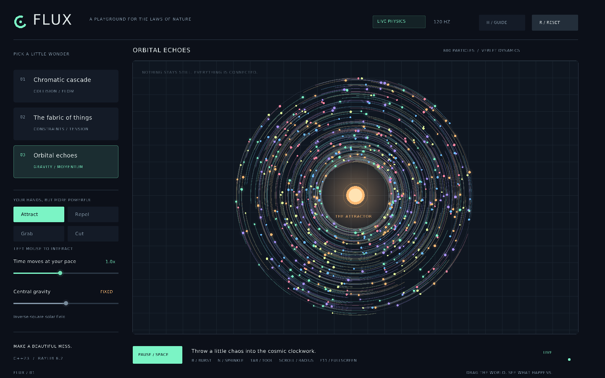

# FLUX — a physics playground

Grab a cloud of glowing particles, pull a hanging sheet out of shape, cut a
hole through it, or disturb a field of tiny orbiting lights. FLUX is an
interactive C++23 simulation with its physics written in readable, commented
code. It is a separate application alongside Afterlight.



[See the cloth experiment](docs/cloth.png).

It uses **raylib 6.2**, which is already in your MSYS2 UCRT64 package list.
It does not use SFML, so the separate SFML 3.0 / 3.1 installations are not
involved in this build. All colors and scenery are drawn in code. The font
and its redistribution license are reused from the repository's `assets`.

## Three experiments

| Scene | What to try |
| --- | --- |
| **Cascade** | Steer hundreds of colored disks around obstacles. Attract them into a cluster, repel them, and launch a radial burst. |
| **Silk** | Pull on a suspended cloth-like net, then switch to Cut and drag through its threads. Watch the remaining constraints carry its weight. |
| **Orbital echoes** | Disturb a field of particles circling a central gravity source. Trails reveal how a small push changes an orbit. |

These are intentionally different models. Cascade uses particle contacts;
Silk uses distance constraints between neighboring nodes; Orbital echoes
uses a central inverse-square attraction. It is a playground for seeing
these ideas, rather than a scientifically calibrated materials simulator.

## Build on your Windows laptop

Use your **MSYS2 UCRT64** terminal, not an old compiler bundled with
Dev-C++. Your supplied package list already includes GCC, CMake, Ninja,
and `mingw-w64-ucrt-x86_64-raylib`.

Download the complete [Project-alpha repository](https://github.com/hassanabbas9871-byte/Project-alpha)
using **Code → Download ZIP**, then extract it. Keep the whole repository:
FLUX reuses the font in its parent folder's `assets` directory.

In UCRT64, enter the new `physics-lab` folder and run:

```sh
cd "/d/Project-alpha-main/physics-lab"
bash scripts/build-ucrt64.sh
./build-ucrt64/flux.exe
```

Replace that example folder with your actual extracted folder. Quote it if
the path contains spaces. The helper checks the selected compiler, finds
raylib in your UCRT64 installation, builds, copies the font, and runs the
physics checks. Its output is in `physics-lab/build-ucrt64`, separate from
Afterlight's build folders.

To confirm package versions or repair a missing tool:

```sh
pacman -Q mingw-w64-ucrt-x86_64-gcc mingw-w64-ucrt-x86_64-cmake mingw-w64-ucrt-x86_64-ninja mingw-w64-ucrt-x86_64-raylib
```

If necessary, install only the missing UCRT64 packages with `pacman -S
--needed` followed by their full package names. Keep the compiler and
raylib from the same UCRT64 environment.

### Launch from File Explorer

After the helper finishes successfully, double-click:

```text
physics-lab/scripts/run-ucrt64.bat
```

The helper records the real UCRT64 runtime folder in
`build-ucrt64/ucrt-bin.txt`. The batch file reads it and supplies the matching
raylib and GCC DLL search path for this application only. It does not modify
your global Windows PATH. This also supports MSYS2 installed somewhere
other than `C:\msys64`.

Use the batch launcher when starting from Explorer. A terminal's temporary
DLL path is not inherited by Explorer, so double-clicking the raw EXE alone
may fail. You can make a desktop shortcut to the batch file. Keep the
installed UCRT64 toolchain and the generated `assets` folder available;
this development build is not a standalone redistributable release.

### Use Embarcadero Dev-C++

Open and edit the `.cpp` / `.hpp` files in Dev-C++, save them, and run the
UCRT64 build helper again. The helper is the reference build and uses all
source files together. Compiling only `main.cpp` in isolation leaves out
the simulation implementation and its linker dependencies.

If you configure a Dev-C++ compiler set, use the GCC in your actual
`msys64\ucrt64\bin` folder. CMake selects C++23 explicitly, so you do not
need to guess an old IDE preset's language flag.

## Controls

The sidebar contains scene buttons, mouse tools, and simulation sliders.

| Input | Action |
| --- | --- |
| `1`, `2`, `3` | Choose Cascade, Silk, or Orbital echoes |
| Left mouse, held inside the experiment | Use the selected Attract, Repel, Grab, or Cut tool |
| Right mouse, held | Repel particles |
| `Tab` | Cycle through mouse tools |
| `Space` | Pause / resume |
| `.` | Advance one physics step while paused |
| `R` | Reset the current experiment |
| `B` | Radial burst at the pointer |
| `N` | Add particles at the pointer where supported |
| `G` | Toggle gravity |
| `H` | Open / close the controls guide |
| `F11` | Toggle fullscreen |

Cut affects cloth threads. Grab moves a nearby particle; release the mouse
to let physics take over again. Particle spawning is bounded so holding a
control cannot grow the simulation's memory without limit. Reset restores
the selected experiment, including torn threads.
The orbit scene uses a fixed central attraction instead of the vertical-gravity
slider. `G` affects Cascade and Silk. `Escape` also pauses / resumes.

## Build on another desktop or in the cloud

Install a C++23 compiler, CMake, and raylib, then configure the **physics-lab
folder**, not the repository root:

```sh
cmake -S physics-lab -B physics-lab/build -DCMAKE_BUILD_TYPE=Release
cmake --build physics-lab/build --parallel 2
ctest --test-dir physics-lab/build --output-on-failure
./physics-lab/build/flux
```

Those commands start in the repository root. If raylib is installed to a
custom prefix, add `-DCMAKE_PREFIX_PATH=/path/to/raylib/install` during
configuration. A graphical display is required for the interactive app.

The cloud toolchain, when prepared in this workspace, is activated with
`source /workspace/.raylib-tools/activate.sh`. These cloud paths do not
apply to your laptop.

## Validation

The test executable runs actual physics scenarios without opening a window
and does not link raylib. Run it through CTest as shown above, or directly:

```sh
./physics-lab/build/flux-physics-tests
```

To build only the physics checks on a machine without raylib:

```sh
cmake -S physics-lab -B physics-lab/build-tests -DFLUX_BUILD_APP=OFF
cmake --build physics-lab/build-tests --parallel 2
ctest --test-dir physics-lab/build-tests --output-on-failure
```

The app also provides graphics-validation modes:

```sh
./physics-lab/build/flux --smoke-test
./physics-lab/build/flux --screenshot flux.png --scene 1
```

Screenshot mode warms up the scene (including a sample drag in Silk), saves
the actual rendered image, and exits. On Windows use
`build-ucrt64/flux.exe` inside UCRT64, or pass the same arguments to the
batch launcher. On Linux without a monitor, use an Xvfb virtual display.
These checks do not turn the desktop simulation into a web app.

## Read the code as a beginner

1. Start at `include/Simulation.hpp`. Its structs describe a particle,
   a connecting thread, and an obstacle. `Simulation` owns the scene.
2. Read `src/Simulation.cpp`. It advances positions and resolves constraints.
   The comments explain the formulas and why the steps run in that order.
3. Read `src/main.cpp` for the window, fixed-time game loop, controls,
   interface, colors, and drawing.
4. Read `src/physics_tests.cpp` to see how simulation behavior is checked
   without needing the window or a human to watch it.

A **position** says where an object is. A **velocity** says how quickly
that position changes. **Acceleration** changes velocity. A fixed time
step gives the solver consistent small slices of simulated time, even when
the graphics frame rate changes. Constraint iterations repair small errors
several times per step instead of expecting a single correction to fix an
entire sheet at once.

`std::vector` is a growable list; the small `Vec` type is one x/y pair.
`const` marks something that a function should not change. Passing an object
by reference with `&` lets a function use the original object. Headers keep
namespaces explicit, while implementation files use `using namespace std;`
where helpful, as requested.

Try one small change at a time: adjust a palette, move a circular obstacle,
or change the initial cloth spacing. Rebuild and compare the result. Keep
physics positions in simulation coordinates; resizing the drawing window
should not change the experiment's real dimensions.

## Troubleshooting

| Symptom | Check |
| --- | --- |
| The helper rejects the terminal | Open **MSYS2 UCRT64** and check `echo "$MSYSTEM"` / `which g++ cmake ninja`. |
| raylib package not found | Check `pacman -Q mingw-w64-ucrt-x86_64-raylib`; use the UCRT64 package with the same compiler. |
| Missing DLL / exit `0xc0000135` from Explorer | Build once with the helper, then use `scripts/run-ucrt64.bat`. Keep the saved runtime folder available. |
| Missing `assets/DejaVuSans.ttf` | Download the entire repository and keep the generated assets folder beside the executable. |
| Old compiler or library still selected | Use a fresh build folder after changing toolchains. CMake remembers earlier settings. |
| Undefined references after compiling one file | Use the supplied CMake build so `Simulation.cpp` and raylib are linked too. |

Linux cloud validation does not establish that a particular Windows laptop
was tested. If a Windows command fails, share the complete command and error
so the actual selected compiler, library, and DLL paths can be checked.
