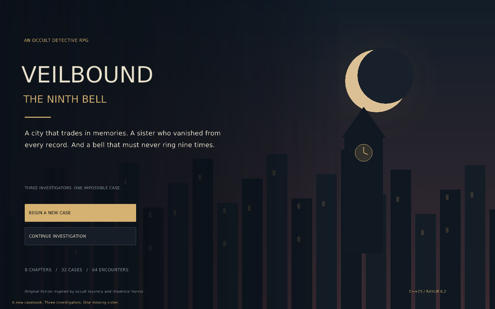

# VEILBOUND: THE NINTH BELL

An original C++23 tactical RPG about missing memories, municipal occult
investigators, and a city that has started hearing a bell which was never
cast. Lead **Rowan Vale**, **Dr Iona Reed**, and **Silas Venn** through
Harrowmere while searching for Rowan's missing sister, Mira.

The atmosphere takes loose inspiration from the early occult mystery and
stagecraft themes of *Lord of the Mysteries: Clown*. The city, characters,
dialogue, plot, and game systems here are original; this is not an adaptation
of the novel's story.

Veilbound is a separate application alongside Afterlight and FLUX. It uses
your installed **raylib 6.2** package, not either SFML installation.

The game opens in a **1600 × 1200** window. Its interface scales proportionally,
with space above and below to preserve the artwork's aspect ratio. Mouse
targets follow the scaled interface. You can resize the window or press `F11`
for borderless fullscreen on your monitor.



[Tactical battle preview](docs/battle.png) · [Campaign caseboard](docs/map.png)

## Campaign and progression

- **Eight chapters and 32 story cases**, with two encounters per case:
  **64 tactical battles** in the campaign.
- Three controllable investigators, with different starting weapons and
  **18 learnable skills** across their three disciplines.
- **24 regular enemy types and eight chapter bosses**, using different
  combat roles such as ranged attackers, healers, stalkers, summoners, and
  guards.
- **24 weapons and 24 equipment pieces**, with attack, defense, health,
  focus, movement, and perk tradeoffs.
- Investigation clues, decisions, a case journal, equipment purchasing,
  level progression, and saved campaign checkpoints.

Requisitions unlock shared loadout patterns: once purchased, an item can be
equipped by more than one investigator. Case endings are also recorded in
the journal, so closing a reward screen never loses its narrative reveal.

The campaign is designed around a **two-hour-or-longer target**: 64 tactical
encounters plus investigation scenes, character progression, and shopping.
That is a pacing estimate, not measured human playtime. Reading speed,
combat choices, retries, and how much equipment you explore affect the
length. There are no mandatory waiting timers added to inflate it. Automated
tests can establish campaign connectivity and system behavior; they cannot
replace a timed human playthrough.

## Build on your Windows laptop

Use **MSYS2 UCRT64**. Your package list already includes the needed GCC,
CMake, Ninja, and `mingw-w64-ucrt-x86_64-raylib` 6.2 package.

Download the complete [Project-alpha repository](https://github.com/hassanabbas9871-byte/Project-alpha)
with **Code → Download ZIP**, then extract it. Keep the whole repository:
the build reuses the licensed font in the parent `assets` folder.

From the UCRT64 terminal:

```sh
cd "/d/Project-alpha-main/veilbound"
bash scripts/build-ucrt64.sh
./build-ucrt64/veilbound.exe
```

Replace the example with your actual extracted folder. Quotation marks keep
paths with spaces together. The helper verifies that UCRT64 tools are
selected, pins raylib to that installation, builds the game, copies its font,
and runs the system tests. It stops at the first failed build or check.

To check the installed tool versions:

```sh
pacman -Q mingw-w64-ucrt-x86_64-gcc mingw-w64-ucrt-x86_64-cmake mingw-w64-ucrt-x86_64-ninja mingw-w64-ucrt-x86_64-raylib
```

Keep all four packages from the same UCRT64 environment. Do not combine
these libraries with an old compiler bundled with Dev-C++, another MSYS2
environment, or Visual C++ libraries.

### Launch from File Explorer

After a successful build, double-click:

```text
veilbound/scripts/run-ucrt64.bat
```

The build records its actual UCRT64 DLL directory in
`build-ucrt64/ucrt-bin.txt`. The launcher restores that directory on `PATH`
for the game process. It does not modify your global Windows settings.
You can make a desktop shortcut to the batch file.

The launcher is useful because Explorer does not inherit a UCRT64 terminal's
temporary DLL search path. Keep the installed UCRT64 tools and the copied
`assets` folder available. Moving only the EXE to a different laptop does
not make this development build a standalone release. If MSYS2 was moved,
rebuild using its current location, or deliberately set `MSYS2_ROOT` for
the launcher.

### Use Embarcadero Dev-C++

Open the `.cpp` and `.hpp` files in Dev-C++ to edit them, save, and rebuild
with the UCRT64 helper. Point any configured compiler set at your actual
`msys64\ucrt64\bin` GCC. CMake supplies the required C++23 setting.

Do not compile `main.cpp` in isolation: that omits the renderer, content,
battle, and campaign implementations and leads to undefined references.
The CMake project builds and links all of them together.

## Playing your first case

Choose **New Game**, then start the current case on the campaign screen.
Read the investigation scene, make its decision, and answer the clue.
Between encounters, inspect your equipment and learned skills. Case rewards
fund new equipment; leveling supplies skill progression.

Combat takes place on a **12 × 8 tactical board**. The active unit receives
action points for its turn. Movement, weapon attacks, and learned skills
spend those points. Skills also use focus and may have cooldowns. Enemy
turns execute automatically; inspect the combat log to understand their
actions. The three investigators share the campaign, but their individual
weapon range, movement, focus, and abilities still matter.

| Control | Action |
| --- | --- |
| Mouse | Select visible buttons and target board cells |
| `M` | Select movement |
| `A` | Select a basic weapon attack |
| `1`–`6` | Select the active hero's corresponding skill |
| `E` | End the active hero's turn |
| `Escape` | Pause / resume a battle, or return from another screen to the campaign |
| `F5` | Save a campaign checkpoint outside combat |
| `F11` | Toggle fullscreen |
| `F10` | Mute / unmute synthesized music and effects |

Select movement and click a reachable tile, or select an attack/skill and
click a valid target. Read the skill description: healing targets allies;
offensive skills target opponents or an affected area. Invalid targets do
not deliberately spend your action points.

Enemy roles require different responses: healers prolong a fight, ranged
enemies punish exposed approaches, and summoners add pressure if left alone.
Cover and line of sight matter. Some cases ask you to survive, seal sites,
or protect progress toward an exit rather than only chase every opponent.

The game includes a quiet generated soundtrack and combat sounds. Launch with
`--mute` to skip audio-device initialization entirely if sound is unavailable.
All sounds are synthesized in code; no external music recordings are bundled.

## Saving and continuing

Campaign checkpoints are saved between encounters, preserving completed
cases, the current encounter, equipment ownership, learned skills, resources,
and the journal. A checkpoint resumes the encounter rather than restoring
an unfinished combat turn. Use **Continue** to resume saved progress.

Default saves live outside the downloaded source/build folders:

- Windows: `%LOCALAPPDATA%\Veilbound\campaign.sav`
- Linux: `$XDG_DATA_HOME/Veilbound/campaign.sav`, or
  `$HOME/.local/share/Veilbound/campaign.sav` when that variable is unset.

The `--save-dir PATH` option selects a different directory, useful for tests
or keeping a separate campaign. Back up the save directory if you want a
second copy of a long-running campaign. Downloading a new source ZIP does
not itself delete a save stored in this external directory.

## Build and test on another desktop

Install a C++23 compiler, CMake, and raylib 6.2. From the repository root:

```sh
cmake -S veilbound -B veilbound/build -DCMAKE_BUILD_TYPE=Release
cmake --build veilbound/build --parallel 2
ctest --test-dir veilbound/build --output-on-failure
./veilbound/build/veilbound
```

For a custom raylib install, add
`-DCMAKE_PREFIX_PATH=/path/to/raylib/install` while configuring. A graphical
desktop/display is required to play interactively.

To test the campaign, combat and save code without raylib or a window:

```sh
cmake -S veilbound -B veilbound/build-tests -DVEIL_BUILD_APP=OFF
cmake --build veilbound/build-tests --parallel 2
ctest --test-dir veilbound/build-tests --output-on-failure
```

The tests use the actual game systems. A test pass is not proof that a human
has played every encounter or measured the campaign's duration.

The app also exposes rendering checks. The smoke test draws 360 frames
across the campaign map, story, inventory, skills, journal, and combat:

```sh
./veilbound/build/veilbound --smoke-test
./veilbound/build/veilbound --screenshot veilbound.png --screen battle
```

Screenshot mode accepts `title`, `map`, `battle`, `story`, `inventory`,
`skills`, or `journal`, renders that screen, and exits. Automated checks use
a temporary save directory unless `--save-dir` explicitly selects another
location. On Windows use
`build-ucrt64/veilbound.exe` from UCRT64, or pass the arguments to the batch
launcher. On a Linux server use Xvfb for graphical checks. These are native
desktop windows, not a browser game or localhost web preview.

## Read the code as a beginner

1. **`include/Types.hpp`** describes the shared data: heroes, enemies,
   equipment, skills, cases, battle units, and saved campaign progress.
2. **`src/Content.cpp`** supplies the story and the equipment/enemy/skill
   definitions. It is the best place to study or change a campaign entry.
3. **`src/Battle.cpp`** implements board movement, action points, targeting,
   enemy behavior, effects, and victory/defeat conditions.
4. **`src/Game.cpp`** connects cases, rewards, purchases, skill learning,
   checkpoints, and screen transitions.
5. **`src/Renderer.cpp`** turns those systems into the game interface, while
   **`src/main.cpp`** owns the window and translates input into commands.
6. **`src/tests.cpp`** runs checks without needing someone to watch a window.

A `struct` groups related values; an `enum class` gives readable names to
choices; a `vector` is a list that can grow. Functions receive inputs and
perform a named operation. `const` promises that a value will not be changed
through that reference. The `.hpp` files describe interfaces; `.cpp` files
provide the instructions. Implementation files use `using namespace std;`
where useful, as requested; headers keep names explicit.

Change one small thing, rebuild, and compare: a weapon's stat, an enemy's
role, a case's clue, or a palette. Keep game rules in the battle/campaign
systems rather than hiding them in drawing code, so their behavior stays
testable without the graphics window.

## Troubleshooting

| Symptom | What to check |
| --- | --- |
| Helper rejects the terminal | Open MSYS2 **UCRT64**; check `echo "$MSYSTEM"` and `which g++ cmake ninja`. |
| raylib 6.2 is not found | Check `pacman -Q mingw-w64-ucrt-x86_64-raylib` and use that matching installation. |
| Explorer reports a missing DLL / `0xc0000135` | Build successfully once and use `scripts/run-ucrt64.bat`; keep its saved runtime directory available. |
| Font is missing | Keep the complete repository for building and the generated `assets` folder beside the EXE. |
| A saved campaign does not load | Keep the file for diagnosis rather than deleting it; report the visible load error. |
| Old compiler/library still selected | Configure a fresh build folder after changing toolchains. CMake remembers earlier choices. |
| Undefined references | Build the CMake project, rather than compiling one `.cpp` file. |

Linux cloud tests do not verify a particular Windows installation. If a
command fails on your laptop, share its command and complete error so the
selected compiler, raylib package, runtime paths, and save path can be checked.
